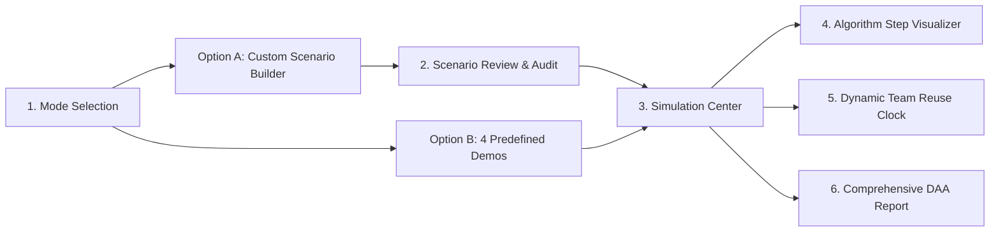

# 🚨 RescueGrid — Intelligent Disaster Response & Relief Optimization System

> **Third-Year College Coursework Project: Design & Analysis of Algorithms (DAA)**  
> *An interactive, discrete-event disaster simulation and multi-algorithm visualization platform.*

[](https://www.typescriptlang.org/)
[](https://react.dev/)
[](https://vitejs.dev/)
[](https://vitest.dev/)
[]()

---

## 📌 Executive Overview

**RescueGrid** is an educational disaster simulation platform designed for college DAA coursework. It demonstrates how four classical computer science algorithmic paradigms—**Divide & Conquer**, **Graph Dynamic Programming / Edge Relaxation**, **Integer Dynamic Programming**, and **Backtracking with State-Space Tree Exploration**—can be integrated into an authoritative, discrete-event simulation engine to solve real-world emergency triage, routing, relief resource allocation, and team dispatch challenges.

The application features a responsive SVG town map, real-time road blockage toggling, dynamic personnel reuse upon task completion, step-by-step algorithm animation traces, and a printable academic DAA audit report.

> [!NOTE]
> **Academic Disclaimer:** RescueGrid is an academic simulation created for teaching and demonstrating algorithmic principles. It does not replace certified emergency dispatch systems.

---

## 🧭 Application Workflow

The user journey is structured into a streamlined 6-stage lifecycle:



1. **Mode Selection**: Choose between building a custom disaster scenario from scratch (**Option A**) or launching one of four curated demonstration scenarios (**Option B**).
2. **Scenario Builder**: Full interactive scenario configuration with form controls for incidents, teams, packages, and truck fleet capacity, alongside a live town map preview with clickable road edges.
3. **Review Mission**: Pre-flight verification screen summarizing all entered metrics, available vs. unavailable personnel, blocked road segments, and capacity limits.
4. **Simulation Center**:
   - **Left Sidebar**: Incident Priority List *only* (rank, name, urgency badge, casualties, status).
   - **Center View**: Prominent SVG town map with wide hit areas; clicking any road directly toggles open/blocked states and recalculates all routes and allocations instantly.
   - **Right Sidebar**: Mission operations panel, selected incident details, route path, allocated supplies, and live discrete-event clock tracking team reuse.
5. **Algorithm Visualizer**: Dedicated step-by-step playback interface with play/pause, step forward/backward, reset, and speed controls for all 4 algorithms.
6. **DAA Audit Report**: Complete post-simulation academic documentation (Sections A through G) with printable layout (`window.print()`).

---

## 🔬 Core DAA Algorithms & Complexity Analysis

| Algorithm | Paradigm | Role in RescueGrid | Time Complexity | Space Complexity |
| :--- | :--- | :--- | :---: | :---: |
| **Merge Sort** | Divide & Conquer | Stable multi-attribute incident triage sorting | $\mathcal{O}(R \log R)$ | $\mathcal{O}(R)$ |
| **Bellman–Ford** | Dynamic Programming / Relaxation | Single-source shortest path routing from HQ under blocked roads | $\mathcal{O}(V \cdot E)$ | $\mathcal{O}(V)$ |
| **0/1 Knapsack** | Dynamic Programming (Tabulation) | Fleet relief cargo maximization under payload capacity | $\mathcal{O}(N \cdot W)$ | $\mathcal{O}(N \cdot W)$ |
| **Backtracking** | State-Space Tree Exploration | Capability-constrained team assignment & dynamic reuse | $\mathcal{O}(M^R)$ worst case | $\mathcal{O}(R)$ depth |

*Where $V = 13$ town nodes, $E \le 19$ road edges, $R = \text{incidents}$, $N = \text{relief package units}$, $W = \text{truck capacity}$, and $M = \text{teams}$.*

---

### 1. Merge Sort — Incident Prioritization

To prevent arbitrary triage decisions during mass-casualty events, Merge Sort deterministically orders incidents using a strict 5-tier tie-breaking policy:

1. **Urgency Tier**: `Critical` (Rank 0) $>$ `High` (Rank 1) $>$ `Medium` (Rank 2) $>$ `Low` (Rank 3).
2. **Medical Emergency Flag**: Life-threatening medical emergencies strictly prioritized over non-medical incidents.
3. **Affected Casualties**: Greater casualty populations prioritized higher to maximize life-saving impact.
4. **Elapsed Waiting Time**: Incidents waiting longer are prioritized to prevent starvation.
5. **Stable Incident ID**: Deterministic lexicographical tie-breaker (`A1` $<$ `B1`) ensuring reproducible sorting.

**Visualizer Features**: Displays the full recursive split tree down to base singletons, records active pairwise comparisons with explicit justification, and renders the intermediate and final priority arrays.

---

### 2. Bellman–Ford — Shortest Path Routing

Calculates optimal routes from Rescue HQ to all incident destinations over the road network:

$$\text{dist}^{(k)}[v] = \min \left( \text{dist}^{(k-1)}[v], \ \text{dist}^{(k-1)}[u] + \text{cost}(u, v) \right) \quad \forall (u, v) \in E_{\text{open}}$$

- **Blocked Roads**: Blocked road edges are excluded from edge relaxation.
- **Honest Unreachable Detection**: If an incident cannot be reached from HQ due to severed road segments, its distance remains $\infty$, reachability is marked `UNREACHABLE`, and no false path or supplies are drawn.
- **Visualizer Features**: Step-by-step edge relaxation animation highlighting the currently examined road directly on the town map, live distance vector updates, predecessor tracking, and pass counters.

---

### 3. 0/1 Knapsack — Relief Package Cargo Allocation

Optimizes the selection of relief cargo packages (e.g., trauma kits, clean water, high-power pumps, food rations) to maximize total people supported while strictly obeying vehicle payload weight capacity $W$:

$$\text{DP}[i][w] = \begin{cases} 
\text{DP}[i-1][w] & \text{if } \text{weight}[i] > w \\
\max\Big(\text{DP}[i-1][w], \ \text{value}[i] + \text{DP}[i-1][w - \text{weight}[i]]\Big) & \text{otherwise}
\end{cases}$$

- **Multi-Unit Expansion**: Packages with quantities $> 1$ are expanded into individual 0/1 items.
- **Inventory & Eligibility Constraints**: Unallocated packages remain in the warehouse. If no incident is reachable or eligible, dispatched relief is set to zero.
- **Visualizer Features**: Interactive 2D Dynamic Programming matrix table, active cell inspection showing include vs. exclude decisions, and backtrack path reconstruction highlighting chosen items.

---

### 4. Backtracking — Team Assignment with State-Space Tree

Matches available rescue teams to emergency incidents subject to feasibility constraints:

1. **Availability Constraint**: Teams marked unavailable (off-duty, damaged equipment) are strictly pruned.
2. **Specialty Compatibility**: Medical tasks require teams with `medical` capability; general evacuation tasks accept `general` or specialized teams; flood rescues require `flood` capability.
3. **Reachability Constraint**: Teams are never dispatched to unreachable locations.
4. **State-Space Tree**: Generates an explicit search tree recording candidate assignments, accepted branches, rejected choices with reasons, and backtracking steps.

---

## ⏱️ Discrete-Event Engine & Dynamic Team Reuse

RescueGrid implements a discrete-event simulation clock to model realistic personnel reuse:

```
T=0 min: Team A dispatched to Incident 1 (travel: 5m, rescue: 10m -> completes at T=15m)
T=0 min: Team B dispatched to Incident 2 (travel: 10m, rescue: 20m -> completes at T=30m)
Incident 3 waits in queue because all teams are busy.

T=15 min: Team A finishes Incident 1!
          -> Incident 1 marked COMPLETED.
          -> Team A is immediately released and REASSIGNED to Incident 3 (starts at T=15m).
          -> Team B continues working on Incident 2 without disruption.
```

- **No Premature Release**: Teams remain busy throughout their active rescue window.
- **Immediate Reuse**: As soon as a team finishes its rescue, it is freed and reassigned to the next waiting compatible incident without waiting for all other teams to finish.
- **No Duplicate Rescues**: Stepping the clock forward or backward preserves task completion states and prevents double-counting saved casualties.

---

## 🗂️ Predefined Demonstration Scenarios

| Scenario | Incidents | Teams | Blocked Roads | Key Learning Objective |
| :--- | :---: | :---: | :--- | :--- |
| **1. Normal Rescue** | 3 incidents | 2 available, 1 unavailable | None (all roads open) | Baseline verification: all incidents reachable, valid Bellman–Ford routes, balanced Knapsack cargo load. |
| **2. Critical Emergency** | 4 incidents | 2 available, 1 unavailable | Society Bypass (`WH ↔ SOC`) | High casualty load, debris blockage forcing detours, critical medical prioritization. |
| **3. Resource Shortage** | 3 incidents | 1 available, 1 unavailable | Society Bypass (`WH ↔ SOC`) | Capacity bottleneck ($W=7$ units) proving Knapsack strictly limits cargo and caps rescued population. |
| **4. No Route Available** | 3 incidents | 1 available, 1 unavailable | All exits from HQ blocked | Demonstrates honesty in algorithm output: `UNREACHABLE` status, distance $\infty$, zero false dispatches. |

---

## 📁 Repository Structure

```
d:\TY\DAA\disaster\
├── index.html                   # HTML entry point with viewport & font imports
├── package.json                 # Project dependencies and npm scripts
├── tsconfig.json                # TypeScript compiler configuration
├── vite.config.ts               # Vite configuration & Vitest test includes
├── cpp/                         # Standalone C++17 implementations for viva
│   └── rescuegrid.cpp           # CLI DAA demonstration program
├── src/
│   ├── main.tsx                 # Main application controller & state coordinator
│   ├── style.css                # Custom design system (light/dark mode, typography)
│   ├── data.ts                  # Fictional town graph (13 locations, 19 roads, packages)
│   ├── algorithms.ts            # Authoritative DAA implementations (BFS, DFS, Dijkstra,
│   │                            #   Bellman-Ford, Merge Sort, Knapsack, Backtracking)
│   ├── algorithms.test.ts       # Vitest suite for pure algorithm correctness
│   ├── simulation.ts            # Discrete-event engine, team reuse scheduler, demo cases
│   ├── simulation.test.ts       # Acceptance tests for Master Criteria #1–#20
│   └── components/
│       ├── ModeSelection.tsx    # Landing page (Option A custom vs. Option B demos)
│       ├── ScenarioBuilder.tsx  # Interactive scenario form + town map preview
│       ├── ReviewMission.tsx    # Pre-launch mission verification audit
│       ├── TownMap.tsx          # Interactive SVG map (curved edges, clickable hit areas)
│       ├── AlgorithmVisualizer.tsx # Step-by-step trace visualizer for all 4 algorithms
│       └── DaaReport.tsx        # Comprehensive DAA audit report (Sections A–G)
```

---

## 🛠️ Quick Start & Running Locally

### Prerequisites
- Node.js (v18 or higher recommended)
- npm (v9 or higher)

### 1. Install Dependencies
```bash
npm install
```

### 2. Start Local Development Server
```bash
npm run dev
```
Open **`http://localhost:5173/`** in your web browser.

### 3. Run Automated Unit & Acceptance Tests
```bash
npm test
```
Runs Vitest across `src/algorithms.test.ts` and `src/simulation.test.ts` (all 27 tests pass).

### 4. TypeScript Type Checking
```bash
npx tsc --noEmit
```

### 5. Production Build & Preview
```bash
npm run build
npx vite preview
```

### 6. (Optional) Run C++17 Console Demonstration
```bash
g++ -std=c++17 -Wall -Wextra cpp/rescuegrid.cpp -o rescuegrid.exe
.\rescuegrid.exe
```

---

## 🎓 Viva Voce & Academic Defense Questions

<details>
<summary><strong>Q1: Why use Bellman–Ford instead of Dijkstra if all road costs are positive?</strong></summary>

*Answer:* While Dijkstra's algorithm ($\mathcal{O}((V + E) \log V)$) is asymptotically faster for nonnegative graphs, Bellman–Ford ($\mathcal{O}(VE)$) provides a pedagogical demonstration of dynamic programming via edge relaxation passes. It natively detects negative-weight cycles (which could model downstream flood elevation gradients or time-credit shortcuts) and allows students to observe step-by-step edge relaxation snapshots pass by pass.
</details>

<details>
<summary><strong>Q2: Why is 0/1 Knapsack pseudo-polynomial?</strong></summary>

*Answer:* The dynamic programming solution runs in $\mathcal{O}(NW)$ time, where $N$ is the number of items and $W$ is the integer capacity. Because $W$ is represented in binary using $\log_2 W$ bits, the running time is exponential with respect to the input length of $W$. It is polynomial in the magnitude of $W$, making it pseudo-polynomial.
</details>

<details>
<summary><strong>Q3: How does dynamic team reuse avoid starvation?</strong></summary>

*Answer:* Incidents are prioritized by Merge Sort using elapsed waiting time as a tie-breaker. The discrete-event queue tracks when each dispatched team finishes its assigned duration. The freed team is immediately allocated to the highest-priority pending incident that is both reachable and compatible, preventing earlier rescues from hoarding teams.
</details>

<details>
<summary><strong>Q4: How does the application ensure state consistency?</strong></summary>

*Answer:* A single authoritative state object (`Scenario`) drives the SVG Town Map, the routing calculations, the knapsack package loader, and the event timeline. When a user clicks a road on the SVG canvas, the edge's `blocked` boolean is toggled in the authoritative scenario state, automatically triggering recalculation of Bellman–Ford distances, reachability statuses, and Knapsack allocations.
</details>

---

## 📜 License & Academic Integrity

This project is submitted for Third-Year Computer Engineering / Information Technology DAA coursework. Code is available for educational and study purposes.
# RescueGrid

